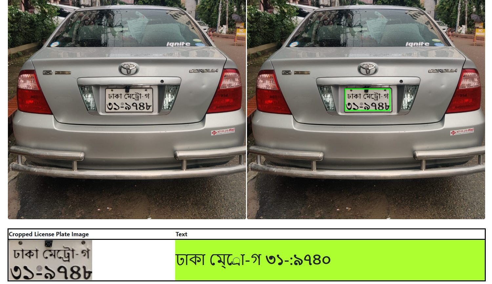
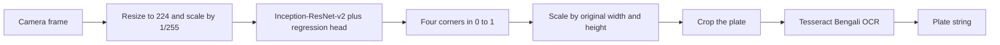

# Automatic Bengali Number Plate Recognition

Localization of Bangladesh Road Transport Authority (BRTA) plates with a fine-tuned **Inception-ResNet-v2** regressor, followed by Tesseract OCR on the cropped plate. The detector is trained in the cloud. This repository holds the annotation table, the training notebook, the inference notebook, and a Flask demo. The checkpoint is about 850 MB, so it is distributed from Google Drive rather than git.



The green rectangle is the Inception-ResNet-v2 box. On this frame the crop shows `ঢাকা মেট্রো-গ` over `৩১-১৯৪৮`, and the recognizer appends an extra `০`. The localizer is doing its job. The remaining error is in the OCR stage, which is the limitation worth reading about below.

**Author:** Ridoy Kanto Joy, B.Sc. in Computer Science and Engineering, Institute of Science and Technology, National University, Bangladesh.  
**Supervisor:** Tania Sultana.  
**Report:** [ProjectBook_ABNPR.pdf](ProjectBook_ABNPR.pdf)

| Resource | Link |
| --- | --- |
| Dataset | [Bangladeshi Vehicle Number Plates](https://www.kaggle.com/datasets/ridoykj/bangladeshi-vehicle-number-plates) |
| Training notebook | [Automatic Bengali Number Plate Recognition](https://www.kaggle.com/code/ridoykj/automatic-bengali-number-plate-recognition) |
| Trained weights | [object_detectionv3.h5 on Google Drive](https://drive.google.com/file/d/14Qfqv4ogmLcycEHugWaZQgp0nxDZRIkq/view?usp=sharing) |
| Local copy of the training notebook | [`automatic-bengali-number-plate-recognition.ipynb`](automatic-bengali-number-plate-recognition.ipynb) |

## Abstract

Most automatic number-plate systems assume a single Latin line. BRTA plates do not. They use Bengali letters and digits, they are set on two lines, and the plate color encodes vehicle class (white with black characters for private vehicles, green with black characters for commercial vehicles). Public data for this format was scarce when the work started, so the plates in this project were photographed and boxed by hand.

The recognition stack is deliberately two-stage. A convolutional network, initialized from ImageNet and trained as a bounding-box regressor, finds the plate. Tesseract then reads the crop. Character-level segmentation is not part of the learned model: the network never sees individual glyphs, only the plate rectangle. The undergraduate report evaluates this pipeline on a corpus of about 1,080 images and, in the abstract, states 99% accuracy at more than 75 frames per second. Chapter 5 of the same report tabulates localization and text-recognition scores against other detectors. Those tables are reproduced below and should be read together with the abstract, not replaced by it.

## Motivation

Vehicle counts in Bangladesh have outgrown manual logbooks. Toll plazas, parking gates, and enforcement cameras need a reader that understands the BRTA layout rather than a Latin one-line plate. The practical constraints are the ones that show up in the collected photographs: glare, night shots, motion blur, distant plates, and owners who do not want their vehicles photographed. A method that only works on a cropped, frontal, high-contrast plate does not answer that setting.

Deep detection is a better fit than hand-tuned edge rules for that variation. Inception-ResNet-v2 was chosen because residual connections keep a very deep Inception backbone trainable, ImageNet initialization supplies edge and texture features the small plate corpus cannot teach from scratch, and a four-value regression head is enough when every image contains one plate. OCR is left to a Bengali Tesseract model so the learned component stays a localizer.

## Repository layout

```text
.
├── README.md
├── requirements.txt
├── LICENSE
├── ProjectBook_ABNPR.pdf
├── automatic-bengali-number-plate-recognition.ipynb   # Kaggle training pipeline
├── Make Prediction.ipynb                              # local localization + OCR
├── docs/figures/webapp_result.jpg                     # demo figure used above
├── csv_label/
│   └── final_labels.csv                               # 1,081 boxes: filepath, xmin, xmax, ymin, ymax
├── models/
│   └── object_detectionv3.h5                          # downloaded; not in git
├── module_webapp/                                     # Flask app, layout unchanged
│   ├── OD_flaskapp.py
│   ├── deeplearning.py
│   ├── templates/
│   └── static/{upload,predict,roi}/
```

`module_webapp/` is the demo. Its Python modules, templates, and static folders stay in place. `deeplearning.py` loads weights from `../models/object_detectionv3.h5` relative to that package, independent of the working directory.

## Methodology

### Data

Plates were boxed in [LabelImg](https://github.com/HumanSignal/labelImg). Each XML box was reduced to the two diagonal corners and written to CSV. The file kept in this repository is [`csv_label/final_labels.csv`](csv_label/final_labels.csv): **1,081** rows with columns `filepath`, `xmin`, `xmax`, `ymin`, `ymax`. The thesis abstract describes the same collection as 1,080 images. Paths inside the CSV point at the Kaggle input layout (`/kaggle/input/bangladeshi-vehicle-number-plates/...`).

Each image is resized to **224 × 224** and scaled by **1/255**. Box coordinates are scaled into \([0, 1]\) by image width for both \(x\) corners and by image height for both \(y\) corners, in the order \((x_{\min}, x_{\max}, y_{\min}, y_{\max})\). `train_test_split` holds out 10% of the rows (`train_size=0.9`, `random_state=0`).

### Detector

The backbone is `InceptionResNetV2(weights="imagenet", include_top=False)` with a 224 × 224 × 3 input. Inception-ResNet-v2 stacks multi-scale convolutions inside residual blocks (164 layers in the classification network described in the report). The ImageNet classification head is discarded. A small regression head replaces it:

```python
from tensorflow.keras.applications import InceptionResNetV2
from tensorflow.keras.layers import Dense, Flatten, Input
from tensorflow.keras.models import Model

backbone = InceptionResNetV2(
    weights="imagenet",
    include_top=False,
    input_tensor=Input(shape=(224, 224, 3)),
)
x = Flatten()(backbone.output)
x = Dense(500, activation="relu")(x)
x = Dense(250, activation="relu")(x)
boxes = Dense(4, activation="sigmoid")(x)
model = Model(inputs=backbone.input, outputs=boxes)
model.compile(loss="mse", optimizer=tf.keras.optimizers.Adam(learning_rate=1e-4))
```

Mean squared error on the four normalized corners matches the target geometry: one plate, four coordinates, no class logits. Training in the Kaggle notebook runs Adam at \(10^{-4}\), batch size 10, for 300 epochs, then continues through epoch 320. TensorBoard logs go to the working `logs/` directory. The checkpoint used by inference is `object_detectionv3.h5`.

At inference the sigmoid outputs are mapped back with \([w, w, h, h]\), where \(w\) and \(h\) are the original image width and height. The rectangle is drawn on the full-resolution image and the interior is the region of interest.

### OCR

The crop is passed to Tesseract with a Bengali model (`lang='ben'` in the notebook; the Flask app calls the `autoocr` wrapper with `lang='bangla'` and a tessdata directory). Tesseract expects a high-contrast, roughly horizontal line of text. Two-line BRTA plates, stylized district names, and low-resolution crops are therefore the main failure mode of the second stage, even when the box is correct. The report discusses this directly: recognition quality follows plate size, contrast, and alignment.

### What this design does not do

There is no anchor grid, no multi-class head, and no learned character classifier. Plates that are heavily tilted, partly occluded, or off the single-box assumption are outside the training target. Comparison detectors in Chapter 5 (EfficientDet, SSD, YOLOv4) are reported as localization and text-recognition baselines. They are not the weights shipped for the demo.

## System workflow



The same path is what the Flask page shows: the upload, the image with the predicted rectangle, the saved crop, and the decoded string.

## Results reported in the thesis

Chapter 5 compares eight localizers. Scores are copied from Tables 1 and 2 of the report. The deployed model is the last column.

**Table 1. Plate localization**

| Metric | EfficientDet D0 | EfficientDet D1 | EfficientDet D2 | SSD MobileNet 320 Lite | SSD MobileNet 640 | SSD ResNet 640 | YOLOv4 | Inception-ResNet-v2 |
| --- | ---: | ---: | ---: | ---: | ---: | ---: | ---: | ---: |
| mAP | 0.9736 | 0.9956 | 0.9831 | 0.9871 | 0.9451 | 0.9843 | 0.9937 | **0.9731** |
| Recall | 0.7393 | 0.7248 | 0.6854 | 0.7665 | 0.7111 | 0.7579 | 0.9800 | **0.9600** |

**Table 2. Text recognition on the same images**

| Metric | EfficientDet D0 | EfficientDet D1 | EfficientDet D2 | SSD MobileNet 320 Lite | SSD MobileNet 640 | SSD ResNet 640 | YOLOv4 | Inception-ResNet-v2 |
| --- | ---: | ---: | ---: | ---: | ---: | ---: | ---: | ---: |
| mAP | 0.9089 | 0.9184 | 0.8940 | 0.9254 | 0.9448 | 0.9359 | 0.9631 | **0.9356** |
| Recall | 0.6869 | 0.7334 | 0.7127 | 0.7497 | 0.7477 | 0.7437 | 0.9800 | **0.9600** |

Read these next to the abstract. The abstract’s 99% figure is higher than the tabulated localization mAP of 0.9731 and the text-recognition mAP of 0.9356. In the same tables, EfficientDet-D1 and YOLOv4 record higher localization mAP, and YOLOv4 records a higher text-recognition mAP. Inception-ResNet-v2 is the model that was trained end to end in the released notebook, saved as `object_detectionv3.h5`, and wired into the web app. Its recall on both tables is 0.9600. The report does not publish per-font or per-illumination breakdowns, so the headline number should not be treated as uniform across those conditions.

Training used a Kaggle environment with a 16 GB NVIDIA Tesla P100. Local prediction in the report was run on an AMD Ryzen 7 4800H under Windows 10. The abstract’s “over 75 fps” figure is stated without a separate hardware note.

## Dataset and training

Reproduce training on Kaggle. Do not commit the raw photographs.

1. Open the [dataset](https://www.kaggle.com/datasets/ridoykj/bangladeshi-vehicle-number-plates) and the [training notebook](https://www.kaggle.com/code/ridoykj/automatic-bengali-number-plate-recognition). A GPU session is required. The notebook enables the GPU accelerator.
2. Run the notebook from top to bottom. It parses plate XML into a label frame, builds the 224 × 224 tensors, splits 90/10, trains the head above, and writes `/kaggle/working/model/object_detectionv3.h5`.
3. Download that file. Put it here:

```text
models/object_detectionv3.h5
```

The notebook in this repository is the same pipeline and still points at `/kaggle/input` and `/kaggle/working`. Run it on Kaggle. Use `Make Prediction.ipynb` on a local machine.

The checkpoint the demo loads is [`object_detectionv3.h5`](https://drive.google.com/file/d/14Qfqv4ogmLcycEHugWaZQgp0nxDZRIkq/view?usp=sharing) (anyone with the link can download it). Older files named `object_detection.h5` and `object_detectionv2.h5` are not used. From the repository root:

```powershell
pip install gdown
gdown 14Qfqv4ogmLcycEHugWaZQgp0nxDZRIkq -O models/object_detectionv3.h5
```

`gdown` follows Drive’s large-file confirmation. A browser download of the same file works too: save it as `models/object_detectionv3.h5`.

## Local setup

Python 3.10 is the version recorded in the Kaggle notebook. TensorFlow 2.10–2.15 matches the Keras `InceptionResNetV2` and `.h5` save format used here.

```powershell
python -m venv .venv
.\.venv\Scripts\activate
python -m pip install --upgrade pip
pip install -r requirements.txt
```

On Linux or macOS, activate with `source .venv/bin/activate`.

Install the [Tesseract](https://github.com/tesseract-ocr/tesseract) binary as well. The Python packages only wrap it. Bengali recognition needs `ben.traineddata` (and, if you use the `bangla` language id, the matching traineddata file) inside the tessdata directory.

Windows default used by the Flask app:

```text
C:\Program Files\Tesseract-OCR\tessdata
```

Override it without editing code:

```powershell
$env:TESSDATA_PREFIX = "C:\Program Files\Tesseract-OCR\tessdata"
```

Download the weights if you have not already, then confirm the file:

```powershell
pip install gdown
gdown 14Qfqv4ogmLcycEHugWaZQgp0nxDZRIkq -O models/object_detectionv3.h5
Test-Path .\models\object_detectionv3.h5
```

### Notebook inference

From the repository root, so `./models/object_detectionv3.h5` resolves:

```powershell
jupyter notebook "Make Prediction.ipynb"
```

The notebook loads the Keras model, denormalizes the four corners, crops the plate, and calls Tesseract (`lang='ben'`). A later cell also shows the `autoocr` wrapper used by the web app.

### Flask demo

```powershell
cd module_webapp
python OD_flaskapp.py
```

Open `http://127.0.0.1:5000`, upload a vehicle photograph, and read the crop and the decoded string. The app saves the boxed frame under `module_webapp/static/predict/` and the crop under `module_webapp/static/roi/`. Those folders are created on startup.

`OD_flaskapp.py` serves with Flask’s debugger. Use it on a local machine only.

`deeplearning.py` raises `FileNotFoundError` with the expected path if `models/object_detectionv3.h5` is missing, instead of failing inside Keras.

## Limitations and further work

The interesting errors are not random. They follow the plate and the camera.

- **Illumination.** Night frames, headlight glare, and shaded plates under trees change the contrast Tesseract needs. The detector can still place a box while the crop is unreadable. The report already flags lighting and weather as limits of existing ANPR.
- **Blur and scale.** A distant or motion-blurred plate occupies few pixels after the crop. Bengali digits then collapse into one another. Resolution at the plate, not the full frame, is the relevant quantity.
- **Font and layout.** District names, vehicle-class letters, and the two-line BRTA arrangement are not a single font. Template assumptions fail when a plate uses an older physical style, extra bolts, or a decorative frame. The collected set mixes normal, bright, dark, distant, blurred, skewed, and tilted shots, but it is still one city’s worth of cameras.
- **Geometry.** The head predicts an axis-aligned box. A strong perspective tilt puts background into the crop and clips the second line. Rotation is not an output of this model.
- **Dirt, damage, and occlusion.** Mud, broken characters, and a partially hidden plate remove the glyphs the OCR stage is asked to read. No amount of clean ImageNet pretraining restores a missing digit.
- **Single-plate assumption.** Training targets one rectangle per image. A frame with two vehicles, or a plate plus a printed phone number on the bodywork, is ambiguous to a four-value regressor.
- **Metric gap.** Localization mAP and the abstract’s accuracy are not the same quantity, and several detectors in Table 1 localize more precisely on the reported numbers. A follow-up should publish IoU histograms, character error rate, and a split by lighting and plate class, on a fixed test list, for Inception-ResNet-v2 and for the stronger localizer in that table.
- **Privacy.** A plate is an identifier. Chapter 6 of the report already asks for access control on stored reads, and for an explicit account of who is allowed to query them. A research demo should not become a silent log of vehicles.

The same chapter points at the engineering follow-ups that would change the system rather than decorate it: a detector that handles tilt and occlusion, an evaluation that separates motorcycles, buses, and trucks, a reader tested on more than one script, and a deployment path that does not require a laptop GPU for every camera.

## Citation

Ridoy Kanto Joy. *Design and Development of Automatic Bengali Number Plate Recognition (ABNPR) by Supervised Machine Learning.* B.Sc. project report, Department of Computer Science and Engineering, Institute of Science and Technology, National University, Bangladesh. Supervisor: Tania Sultana.

Selected prior work cited in that report includes Joarder et al. on Bangla ANPR with neural networks (2012), Baten et al. on template matching for metropolitan plates (2014), Haque et al. on line segmentation (2016), and Rahman et al. on CNN recognition of Bangla plates (2018). Full references are in `ProjectBook_ABNPR.pdf`.

## License

The code, notebooks, and documentation in this repository are released under the [MIT License](LICENSE). `ProjectBook_ABNPR.pdf` is the author’s project report and is included so the experiment can be read beside the code. The trained weights are shared separately from Google Drive for the same research use. Photographs of real plates identify vehicles; do not build a surveillance log from them.
